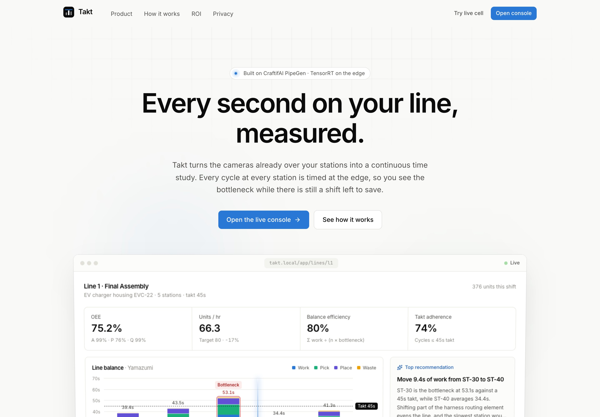
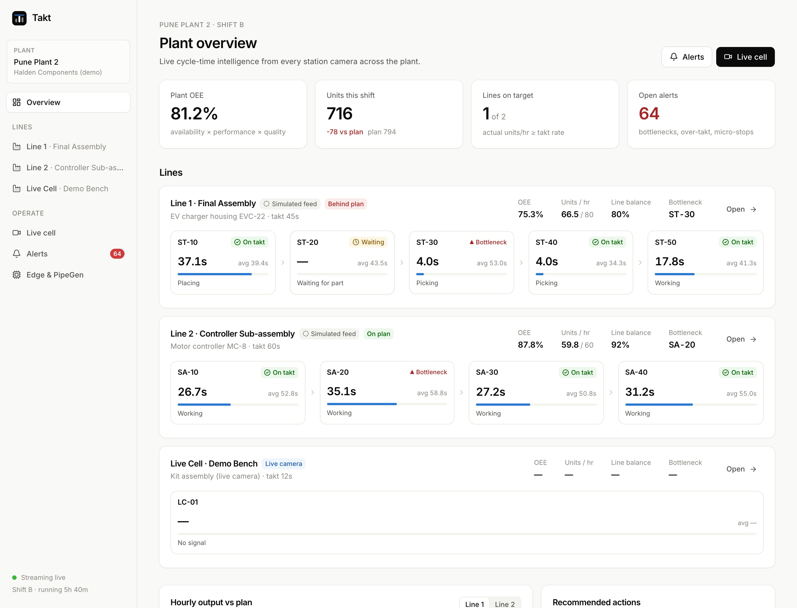
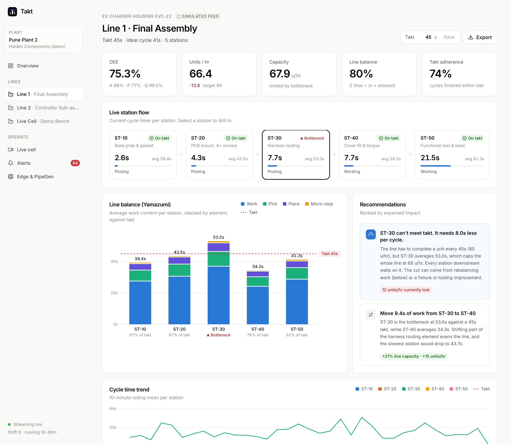
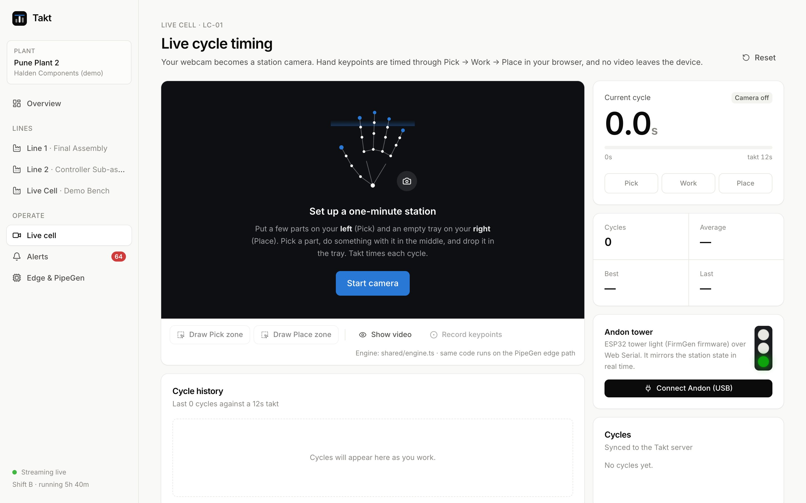
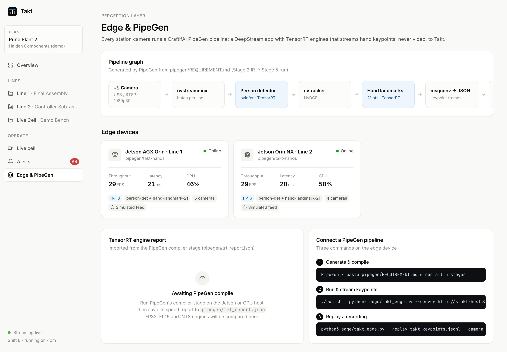
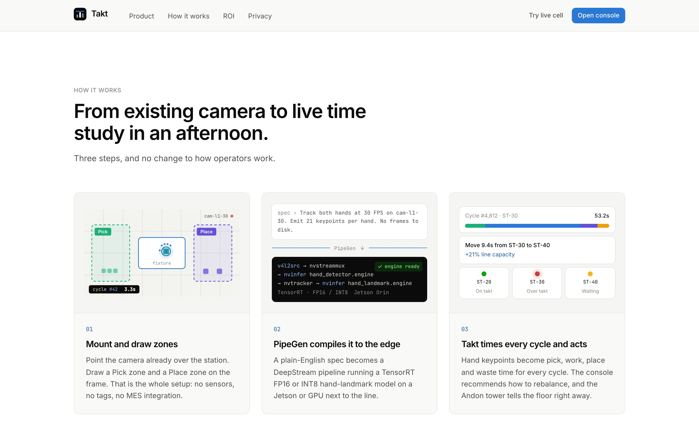

<div align="center">

# Takt

### The AI time-and-motion engineer for assembly lines

**Every second on your line, measured.**

Takt turns the cameras already mounted over each assembly station into a continuous time study.
Every work cycle at every station is timed on edge GPUs, through a **CraftifAI PipeGen** pipeline, so
you can see the bottleneck while there is still a shift left to save.

[**Live demo**](#live-demo) · [How it works](#how-it-works) · [PipeGen integration](#pipegen-integration) · [Run locally](#run-locally) · [Architecture](#architecture)

<br />



</div>

---

## The problem

Manual assembly lines (auto components, electronics, appliances) run to a **takt time**: the pace needed
to meet customer demand. To find out where time is lost, an industrial engineer still stands at the
station with a **stopwatch** and times a few dozen cycles, once or twice a year.

That study is stale the day it is typed up. Operators rotate, the product mix changes and work content
drifts, so the **bottleneck moves**. Nobody sees it until output is missed at the end of the shift.

| | Manual time study | **Takt** |
|---|---|---|
| Sample | A few dozen cycles | **Every cycle**, thousands per shift |
| Cadence | Once or twice a year | **Continuous** |
| Method | Stopwatch and clipboard | **Existing cameras**, timed automatically |
| Bottleneck | Found after output is missed | **Flagged as it forms, with a fix** |

## What Takt does

<table>
<tr>
<td width="50%"></td>
<td width="50%"></td>
</tr>
<tr>
<td><b>Plant overview.</b> OEE, output against plan, every station live, and recommended actions.</td>
<td><b>Line detail.</b> Yamazumi line balance against takt, the bottleneck, ranked rebalancing recommendations, trends and distributions.</td>
</tr>
<tr>
<td width="50%"></td>
<td width="50%"></td>
</tr>
<tr>
<td><b>Live cell.</b> A webcam becomes a station camera. Draw Pick and Place zones, and every cycle is timed live, with an Andon tower over Web Serial.</td>
<td><b>Edge &amp; PipeGen.</b> The DeepStream pipeline graph, the edge devices, and the TensorRT engine report.</td>
</tr>
</table>

- **Cycle time per station.** Every cycle is split into *Pick · Work · Place · Micro-stop*, with mean, median, P90 and CV.
- **Yamazumi line balance.** Stacked work content per station against takt, plus a balance-efficiency figure.
- **Bottleneck and rebalancing.** For example: *"Move 9.4s of work from ST-30 to ST-40, for +21% line capacity and +15 units/hr."*
- **Live OEE.** Availability × performance × quality, computed from real cycles.
- **Alerts.** Bottleneck shifts, over-takt streaks, micro-stops and offline cameras, pushed in real time.
- **Andon closed loop.** An ESP32 tower light (firmware from a FirmGen PRD) turns green, amber or red per station.
- **Privacy by design.** Only 21 hand keypoints and timings leave the edge. There is no video, no faces and no identity. Takt measures *the process, not the person*.

## How it works



1. **Mount and draw zones.** Point the existing station camera at the work and draw a *Pick* zone and a *Place* zone.
2. **PipeGen compiles it to the edge.** A plain-English spec becomes a DeepStream app with TensorRT FP16/INT8 hand-landmark engines on a Jetson or GPU.
3. **Takt times every cycle and acts.** A debounced state machine (`shared/engine.ts`) turns keypoints into timed cycles. The analytics (`shared/analytics.ts`) find the bottleneck and recommend a rebalance, and the Andon tower tells the floor.

## PipeGen integration

PipeGen **is** Takt's perception layer. Without it there are no keypoints, and without keypoints there are no cycles.

| PipeGen stage | In this repo |
|---|---|
| 1. Requirement | [`pipegen/REQUIREMENT.md`](pipegen/REQUIREMENT.md): the spec, including the exact output schema Takt consumes |
| 2. Pipeline IR | [`pipegen/pipeline_ir.json`](pipegen/pipeline_ir.json): detector → NvDCF tracker → secondary hand-landmark nvinfer → msgconv → MQTT/stdout |
| 3. Model | Detector and 21-point hand-landmark ONNX models |
| 4. Compiler | The TensorRT report is saved to `pipegen/trt_report.json` and rendered on the console's **Edge & PipeGen** page |
| 5. Run | `./run.sh \| python3 edge/takt_edge.py --server http://<takt-host>:8787 --camera cam-l1-30` |

[`edge/takt_edge.py`](edge/takt_edge.py) is the bridge. It normalises DeepStream frames (pixel or normalised coordinates, from stdin or MQTT), batches them to `/api/ingest/frames`, and sends device heartbeats with FPS and latency. It can also **replay** recorded keypoints:

```bash
python3 edge/takt_edge.py --replay docs/sample_pipegen_keypoints.jsonl --camera cam-live
```

## Architecture

```
Station camera ─▶ PipeGen DeepStream app (TensorRT hand-landmark ×21, FP16/INT8) ─ JSON keypoints ─┐
                                                                                                   ▼
Browser Live cell (MediaPipe, same engine code) ── cycles ──▶  Takt server  ◀── edge/takt_edge.py
                                                               shared/runtime.ts (plant runtime)
                                                               shared/engine.ts  · shared/analytics.ts
                                                               SQLite · REST · WebSocket
                                                                    │
                                    Takt console (React) ◀──────────┴──────▶ Andon tower (ESP32 · FirmGen)
```

The whole plant runtime (simulator, ingest, alert rules and REST API) lives in `shared/runtime.ts` as a
pure request handler:
- **`npm start`** wraps it in Node HTTP, WebSocket and SQLite, for real deployments with PipeGen edge devices.
- **The hosted demo** runs the *same* runtime inside the browser with an in-memory store, so it works on
  static hosting with no backend.

## Live demo

**▶ https://takt-console.vercel.app**

The hosted demo runs entirely in your browser:
- **Lines 1 and 2** are a simulated plant, labelled *Simulated feed* in the UI. It is a coupled flow-line
  model with log-normal cycle times, a real bottleneck, starvation downstream and micro-stops, and it
  goes through exactly the same analytics as live data.
- **Live cell** uses *your* webcam. Hand keypoints are timed in the page, and no video leaves the device.

## Run locally

Requires **Node 22.13 or later**. There are no other services to install.

```bash
npm install
npm run dev            # API on :8787 and console on http://localhost:5173 (hot reload)

npm run build && npm start   # production: everything on http://localhost:8787
npm test               # engine, analytics and offline-state tests
```

| Route | Page |
|---|---|
| `/` | Landing page |
| `/app` | Plant overview |
| `/app/lines/l1` | Line detail: Yamazumi, trends, recommendations |
| `/app/live` | Live webcam cell |
| `/app/alerts` | Alerts |
| `/app/edge` | Edge devices and PipeGen |

## Closed loop: Andon tower (FirmGen)

[`firmgen/PRD.md`](firmgen/PRD.md) is the frozen PRD for the ESP32 tower light. It defines the UART
protocol `ANDON,<station>,<G|Y|R>` and `CYCLE,<station>,<s>`, along with button acknowledgement, a link
watchdog and latency budgets. The Live cell drives it directly over **Web Serial**.

## Repo layout

| Path | Purpose |
|---|---|
| `shared/` | `engine.ts` (cycle state machine), `analytics.ts` (OEE, balance, recommendations), `rules.ts` (alerts), `runtime.ts` (plant runtime and API), `sim.ts`, `plant.ts`, tests |
| `server/` | Node HTTP and WebSocket server with a SQLite store |
| `web/` | React 19 console and landing page: Vite, Tailwind v4, GSAP, Recharts, MediaPipe |
| `edge/takt_edge.py` | PipeGen → Takt bridge (stdin, MQTT or replay) |
| `pipegen/` | Stage-1 requirement, target IR, and the TensorRT report slot |
| `firmgen/PRD.md` | ESP32 Andon tower PRD |
| `docs/` | Plan, sample keypoint streams, screenshots |

## Tech

TypeScript end to end, React 19, Vite, Tailwind CSS v4, GSAP, Recharts, MediaPipe Tasks (in-browser
hand landmarks), Node 22 (`node:sqlite`, `ws`), and Python 3 (stdlib edge bridge). The perception layer
is CraftifAI PipeGen with NVIDIA DeepStream and TensorRT.

---

<div align="center">

Built for <b>HackwithBangalore 4.0</b> · PipeGen track

</div>
